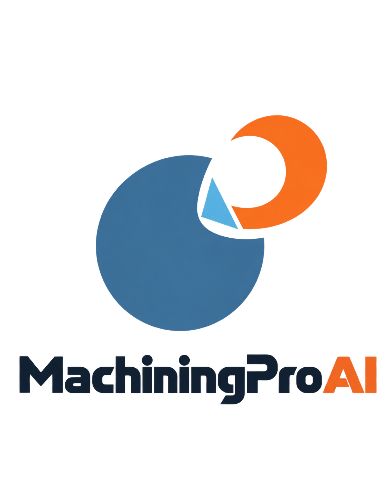

# MachiningPro AI

<p align="center">
  
</p>
**Deterministic-first machining engineering with AI-assisted, explainable decision support.**

**Status:** Alpha Engineering / Research Preview
**License:** MIT
**Latest published pre-release:** `v0.1.0-alpha.10`

## What is MachiningPro AI?

MachiningPro AI is an open-source engineering software project for machining analysis, engineering interoperability, and manufacturing-planning foundations.

Its core principle is simple: **deterministic engineering calculations are authoritative**. AI-assisted functionality, where used, is advisory and must not silently override validated deterministic results.

The current public repository is intended for engineering evaluation, research, software verification, and controlled demonstrations.

## Engineering Principles

- Deterministic engineering calculations are authoritative.
- Engineering results should be reproducible and traceable.
- Units, assumptions, and engineering inputs should be explicit and reviewable.
- Invalid supported physical inputs should fail clearly rather than silently default.
- AI-assisted functionality, where used, is advisory and explainable.
- Human engineering review remains required.

## Current Public Capabilities

### Machining
- core machining formulas
- turning
- milling
- drilling
- threading and tapping
- hole finishing
- honing
- lapping
- tool-life analysis
- surface-roughness analysis

Supporting public packages provide domain models and foundations for machine data, cutting parameters, empirical engineering data, DFM, and process planning.

### Interoperability and Technical Drawings
- STEP adapter and mapping infrastructure
- IGES adapter and parser infrastructure
- DXF adapter infrastructure
- geometry, topology, exchange, and normalization models
- technical-drawing models
- PDF and raster drawing-processing infrastructure
- OCR and VLM-related drawing-processing infrastructure

These components do not constitute a full production CAD kernel.

### Planning
- planning domain models
- operation eligibility logic
- routing foundations
- calendar constraints
- scheduler foundations
- solver models
- optimizer-adapter infrastructure

These components are engineering planning foundations and are not presented as a production-qualified scheduling system.

### NC Program Analysis

The NC Program Analysis module parses NC / G-code program text as **data only** and produces deterministic engineering results. It does not execute NC programs or simulate machine motion.

**Parser profile:** GENERIC_ISO_GCODE_SUBSET — targets common ISO 6983-compatible G-code
**Release maturity:** CUSTOMER_DEMO_READY

#### Supported
G0, G1, G2/G3 (IJK arcs), G17/G18/G19, G20/G21, G80–G85, G90/G91, G94, G97, G98/G99, M3/M4/M5/M6

#### Bounded (partial semantics)
G41/G42 (cutter comp detected, offset path not computed), G86–G89 (detected, not expanded)

#### Deferred (BLOCKED_BY_KNOWN_LIMIT)
G96 CSS, G93 inverse-time, R-format arcs, G91 in canned cycles, L-repeat, machine feed-rate limit

#### Not Supported (UNSUPPORTED_SEMANTICS)
M98/M99 subprograms, `#` macro variables, WHILE/IF flow control

#### Key Features
- Feed and rapid motion distance extraction
- RPM hard-limit validation against machine, tool, and holder catalog
- Engineering review findings (BLOCKING / WARNING / ADVISORY / INFO)
- Traceability: SHA-256 program + config + analysis fingerprints, audit log
- Block-level NC change review between program revisions
- Export: JSON, CSV (findings, segments, coverage, changes), Print/PDF
- EN/TR internationalization
- Responsive layout (390px mobile, 1024px tablet, 1440px desktop)

See [`docs/nc/NC_MODULE_RELEASE.md`](docs/nc/NC_MODULE_RELEASE.md) for the full feature matrix, demo scenarios, customer limitations, and release notes.

#### NC Analysis Safety

`NC_FILE_EXECUTED=NO` — NC program text is parsed as data only, never executed.
`NC_FEED_MOVE_EQUALS_CONFIRMED_CUTTING=NO`
`NC_CHANGE_REVIEW_IS_NOT_APPROVAL=YES`
`HASH_EQUALS_DIGITAL_SIGNATURE=NO`

### Frontend
- application shell
- login/auth client integration
- engineering dashboard and workspace status
- grouped navigation by engineering domain
- capability pages that explicitly identify pending frontend integration
- NC program analysis workflow (process planning page)

Backend capability does not imply that a complete frontend workflow is already available.

## Repository Architecture

```text
backend/
  core/
  cutting_parameters/
  dfm/
  domain/
  empirical/
  interoperability/
  machines/
  machining/
  planning/
  process_planning/

frontend/
  app/
  static/media/machining/

docs/
tests/
pyproject.toml
README.md
LICENSE
```

## Quick Start

### Python

Python 3.11 or newer is required.

```text
py -m pip install -e ".[dev]"
py -m pytest
py -m ruff check backend tests
```

### Frontend

```text
cd frontend/app
npm ci
npm run build
npm run dev
```

## Validation Status

`PRODUCTION_MODEL_APPROVED=NO`

`PQ03_ENTRY_READY=NO`

MachiningPro AI is an **alpha engineering/research preview**.

Public availability does not imply customer-specific, production-process, regulatory, or safety approval.

## Current Limitations

- This release is not production-qualified.
- Some backend capabilities are not yet integrated into complete frontend workflows.
- Interoperability foundations are not a full production CAD kernel.
- No production CAM toolpath-generation capability is claimed.
- Interactive 3D engineering visualization is not part of the current public implementation.
- Final manufacturing decisions require engineering review of inputs, assumptions, machine limits, tooling limits, and process constraints.

## Roadmap

Future directions, not claimed as implemented:

- deeper CAD and geometry integration
- manufacturing feature recognition
- expanded DFM and manufacturability analysis
- expanded process-planning workflows
- machine and cutting-tool selection support
- inspection and measurement planning
- cost and cycle-time analysis
- interactive 3D engineering visualization
- production-depth AI-assisted engineering workflows

## Public Data Policy

Private validation workbooks, local research collections, development patches, and internal working material are not part of the public release.

## License

MachiningPro AI is distributed under the MIT License. See [LICENSE](LICENSE).

## Release

Latest published pre-release: **v0.1.0-alpha.10 - Clean Public Alpha Engineering Preview**

The `main` branch may contain validated fixes made after the latest published pre-release.